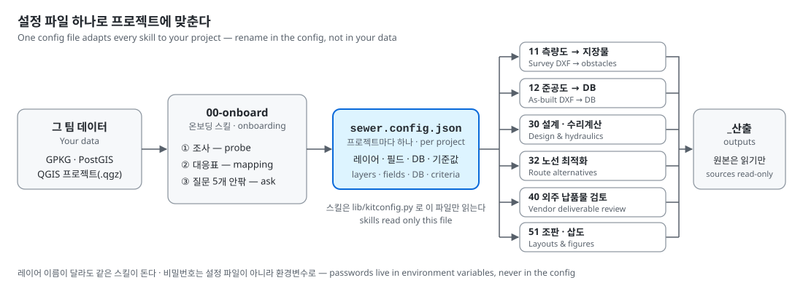
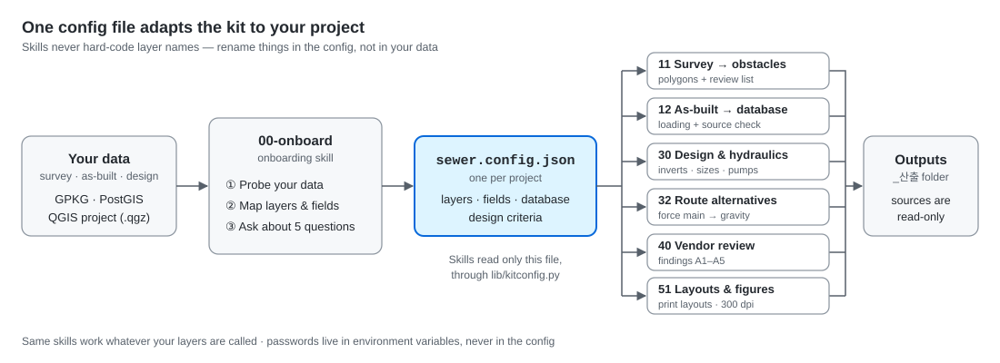
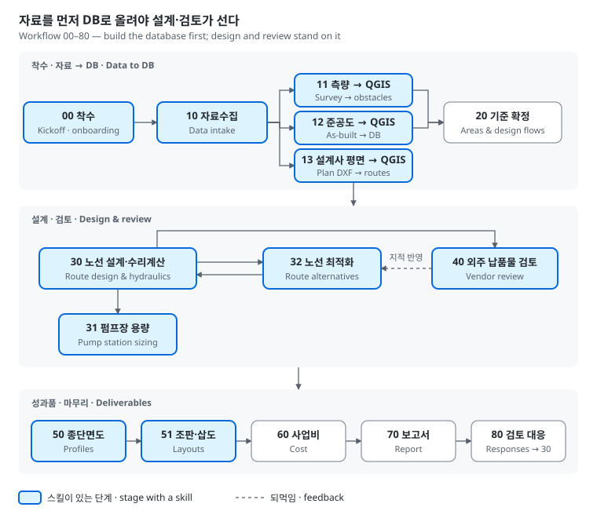
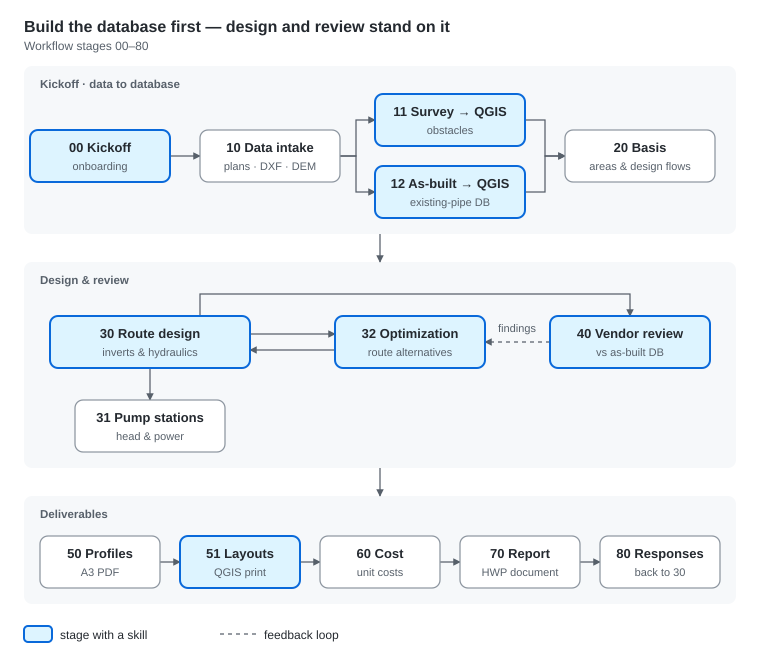
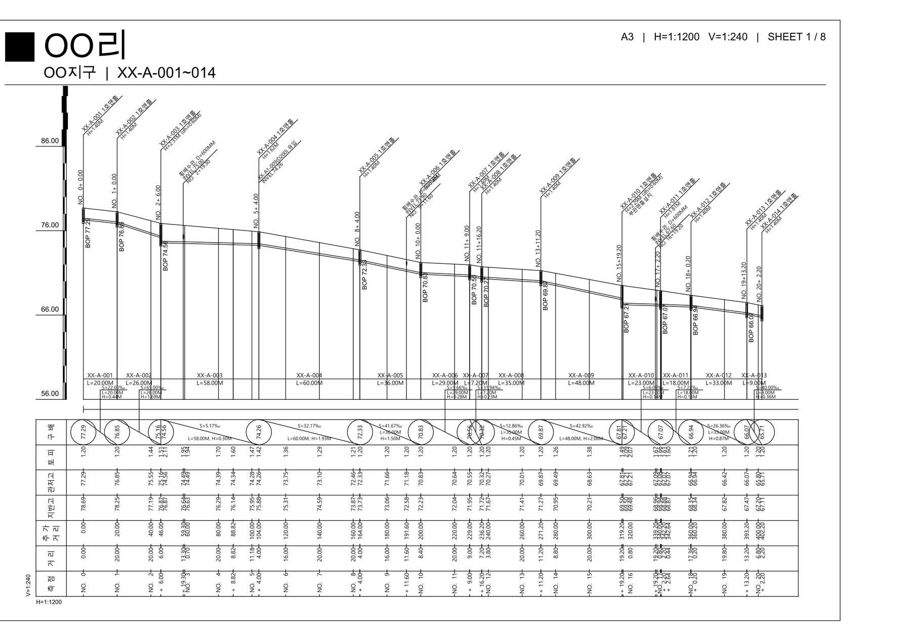
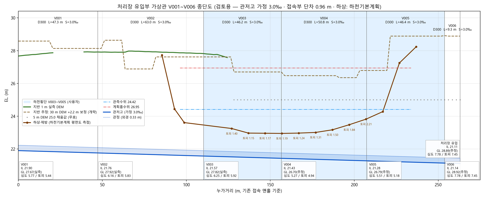
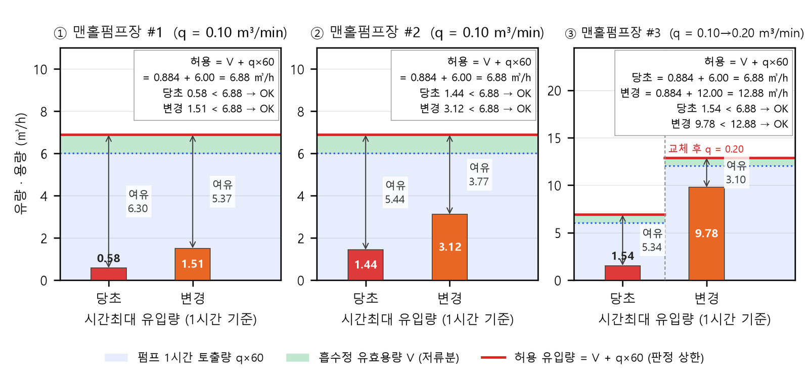

English | [한국어](README.md)

# qgis-water-sewer-kit: Claude + QGIS for Water & Sewer Network Design & Review

A skill kit for doing water-supply and sewer design and review on top of QGIS data while handing the repetitive
work to [Claude Code](https://claude.com/claude-code) — packaged so **each team can adapt it to its own project**.
People don't memorize procedures; Claude reads the kit's skills and runs them.

> Right now the kit contains **sewer-network skills only**. Water-supply skills are planned.
> The skills and docs are written in Korean, following Korean design standards (KDS) and Korean drawing conventions.

The skills and scripts never hard-code layer names. They read layers, fields, the database connection and design
criteria from a single `sewer.config.json` at the project root. If your layer names differ, you change the config —
not your data. The onboarding skill writes that config by surveying your data.

## What people do — three things
1. **Install** — tell Claude Code: "Install https://github.com/taylee9809/qgis-water-sewer-kit following its INSTALL.md."
2. **Set up** — in your project folder: "Set up the kit for this project." Claude surveys your data and asks only about what it cannot settle (about five questions).
3. **Ask and check** — pick a task from the table below and check the result against "Before you trust a result".

Requirements: Claude Code · QGIS 3.22+ (3.40 LTR recommended) · Python 3.10+. PostGIS is optional.

## What you can ask for
| Say something like | Skill | Result | What a person checks |
|---|---|---|---|
| "Bring in the DEM, water mains, flows and household data" / "Export households to Excel" | 10 | 1 m / 5 m DEM, water-main GPKG, flow-basis table, household Excel round trip | Rows in = rows loaded; only rows edited in Excel changed |
| "The survey came in — build the obstacle layer" | 11 | Obstacle polygons and centerlines + a **needs-review** layer | The needs-review list (usually 3–5 items), against drawings and street view |
| "Load the as-built DXF into the DB" / "Is the as-built DB right?" | 12 | As-built pipes and manholes loaded + a comparison against the source | Coordinate offset converged (within 0.2 m); zero mismatches in names, ground levels, depths |
| "Turn the consultant's plan DXF into plan layers" | 13 | Planned pipe, manhole and pump-station layers + a comparison against the source | Zero mismatches in pipe IDs, diameters, lengths; existing pipes flagged |
| "Run inverts and hydraulics for this route" | 30 | Inverts, diameters, flows, pass/fail, makesw `.flo`, SWMM `.inp`, `설계요약.md` | Which values are standards and which are assumptions; sections short of cover or velocity |
| "Size the pump stations" / "Do the existing stations hold?" | 31 | Head, power and wet-well storage per station, capacity workbook | Static head and loss sources; verdict for existing stations |
| "Can we drop this force main?" / "Compare connection manholes" | 32 | Feasible manholes + an alternatives table | Cover and deep-excavation stretches; operating cost |
| "Review the consultant's delivery" (folder name only) | 40 | `검토요약.md` — findings on lengths, network, connection inverts, designer notes | Each finding as "delivered vs reference — difference — impact" |
| "Print the profiles on A3" / "Draw a profile per route" | 50 | A3 sheet-set PDF (village names in titles), profile DXF in the consultant's format, review-profile PDF | Zero missing titles, zero clipped lines; rotated text intact |
| "Make a location figure for this section" | 51 | Print layout + 300 dpi image | Overlaps, clipping, empty legends (by eye) |
| Other stages (cost, report, review responses) | — | Claude writes project scripts under `scripts\` | Sources of numbers; standards vs assumptions |
| "Send my kit changes back" | 90 | A bundle of fixes, failure notes and new tools → PR, issue or file | Zero hits in the name scan; what is being sent |

## Starting from DXF files only
No database needed. Say "Set up the kit for this project" and skill 00 builds an empty GPKG and config from the standard schema; then ask for each step in order.

1. **00** empty DB and config → **10** bring in DEM, water mains, flow basis, households
2. **11** survey DXF → obstacles · **12** as-built DXF → existing network · **13** consultant plan DXF → planned routes (or draw them in QGIS)
3. **30** inverts, hydraulics, `.flo` → **31** pump-station capacity → **32** alternatives
4. **50** A3 profiles · **51** layouts and figures → when a consultant delivers, **40** review

Service areas and flows (20) and cost, report and review responses (60–80) have no skill — Claude writes project scripts under `scripts\` following `standard/workflow.md`.

## Workflow

For each request Claude first decides which stage it belongs to. Stages with a skill follow the skill; the rest get
project-specific scripts. **Vendor review (40) only holds if the as-built DB (12) is right** — check stage 12 before
stage 40.

## Examples of the output
Made on real projects; place names, pipe IDs and river names are masked (`OO`, `XX-`).

**An A3 profile sheet** — the consultant's drawing format, with pipe IDs, inverts and cover read from the bands and redrawn. Vendor review (40) reads this format.

**A review profile** — a pipe at a treatment-plant inlet checked against a river crossing, flood level and cover (30·32).

**Manhole pump-station wet-well check** — whether pump output plus storage still holds when inflow changes, per station (31).

## Before you trust a result
- **Are the sources untouched?** The kit only reads source data and writes outputs under `_산출\`. Any DB change must come with the backup table name and the number of rows changed.
- **Is "zero" different from "not surveyed"?** Where there is no survey, obstacles are "not surveyed", not "zero crossings".
- **Standard or assumption?** Numbers headed for a report must say whether they come from KDS / the project brief or from an assumption Claude made.
- **Is judgment left to people?** Cases the drawings cannot settle must come back as a review list, not be decided by Claude.

## Layout
| Folder | Contents |
|---|---|
| `skills\` | Twelve skills — 00-onboard · 10 · 11 · 12 · 13 · 30 · 31 · 32 · 40 · 50 · 51 · 90-kit-feedback |
| `lib\kitconfig.py` | Config loader used by every script (paths, layers, fields, DB; passwords only via environment variables) |
| `lib\flospec.py` | Read, validate and write makesw `.flo` files (shared by 13, 30, 31, 40) |
| `standard\` | Data standard (logical layers and fields) · **DB design guide** (entities, relations and rules when you build a DB from scratch) · workflow · two pitfall notes |
| `templates\` | `sewer.config.example.json` (a real project's layout as the example) · `db_schema.json` (standard schema — generates an empty GPKG or PostGIS DDL) · a `CLAUDE.md` for project folders |
| `assets\svg\` | SVG templates for print layouts and figures — title boxes, legends, key tables, section tags, road-view badges, place labels, map icons; `make_svg.py` fills in the text (tag width computed) · preview `preview.png` |
| `docs\` | Images for this README |

## What was verified, and known limits
- Every skill's scripts were run against real project data and **match the original tools** — 11: CSVs byte-identical; 12 and 32: identical output; 40: identical A1–A5; 13: 1,470 pipes, 1,234 manholes, 33 pump stations identical; 30: zero mismatches over 190 sections and 231 `.flo` lines; 31: zero differences over 17 stations × 38 items; 50: titles and pipe IDs identical on all 28 A3 sheets; 10: identical DEM arrays.
- Skill 30's scripts do not place manholes automatically or design excavation and shoring (see 30 SKILL.md §10.6). makesw `.OUT` result tables need the makesw program itself.
- PostGIS reading was checked against a real database for 12 and 32 only; 11 and 40 were checked with GPKG. Teams on PostGIS should eyeball the first run.
- Skill 11 **writes obstacle layers to GPKG only**.
- Skill 11's tools read the config first, so run them **inside a project folder** (outside one, even `--help` only prints the setup hint).
- DXF layer names and label radii are **one surveyor's / designer's drawing conventions**. For other firms' drawings, change them in the config (`asbuilt.dxf_layers`, `review_vendor.profile`) or via arguments; for 11, edit the layer list in the tool README.

## Companion tools
- [Sewer Profile Viewer](https://github.com/taylee9809/qgis-sewer-profile) — QGIS plugin: route section tree + profile view. Claude installs it during setup.
- [QGIS MCP](https://github.com/jjsantos01/qgis_mcp) (optional) — lets Claude drive a running QGIS.
- [korean-engineering-mcp](https://github.com/sonmeggy/korean-engineering-mcp) (optional) — search Korean construction standards (KDS/KCS) and statutes, verify citations, look up standard estimates. Skill 30 uses it to check clauses against the source. Each user gets their own API keys.

## Sending changes back, and updating
- Use the kit on a **`local`** branch (created at install). Each team's fixes stay there as commits and survive updates.
- **Usage sharing** (one-time opt-in at install): each team changes the kit with its own Claude. When a Claude Code session starts or ends, a hook pulls out **only kit-related facts** — which skills and scripts ran, success or failure with the last error line, `local`-branch changes, the shape of the config — and pushes them to that team's fork. Project paths, place names and company names are stripped; anything that still matches is held back. Conversations and data are never sent.
- The maintainer runs `collect_feedback.py` once to gather every team: usage per team, failures grouped by error, and each team's kit changes as patches.
- Teams that don't opt in can tell Claude **"send my kit changes back"** — 90-kit-feedback bundles them, scans for project names, paths and passwords, and **asks you before** sending a PR, an issue or a file.
- The maintainer reviews (including a regression run) and merges; everyone gets it on the next update. Anything not merged stays on your `local` branch.
- Update: `git -C <kit> fetch origin` → `git -C <kit> rebase origin/main`. Skills are linked by junctions, so nothing needs re-linking.
- Details: [CONTRIBUTING.md](CONTRIBUTING.md) · maintainer process: [MAINTAINING.md](MAINTAINING.md) · [CHANGELOG.md](CHANGELOG.md)
