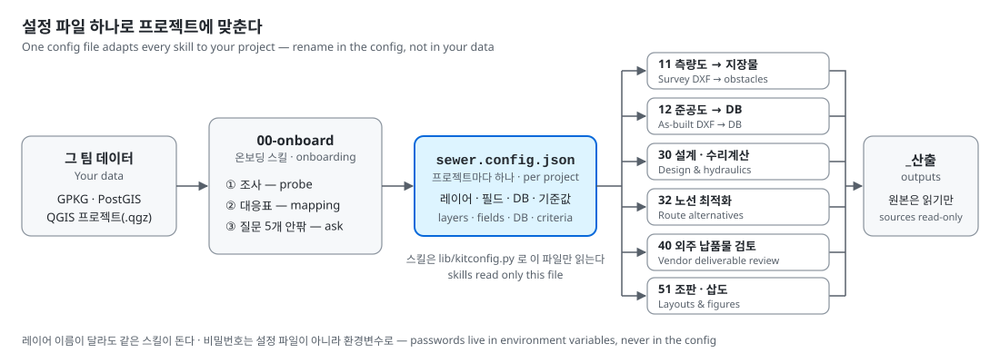
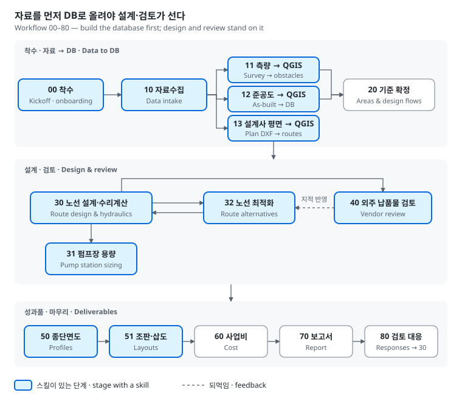
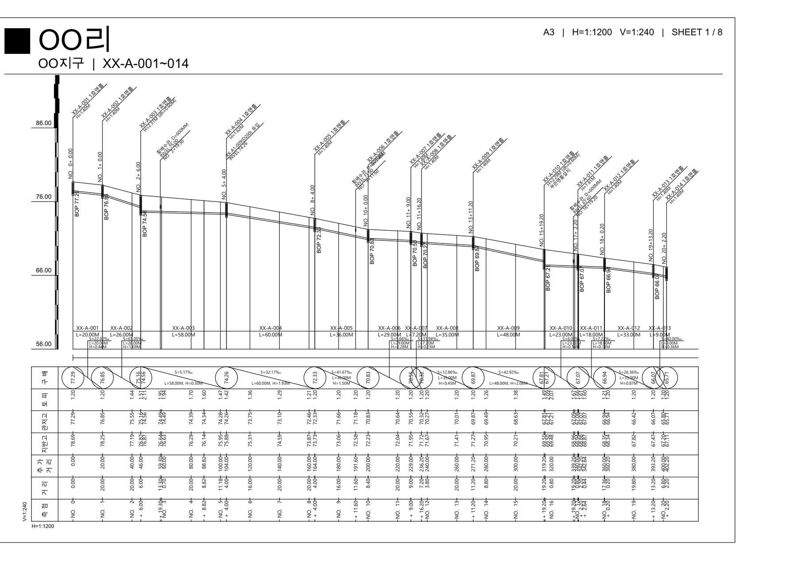
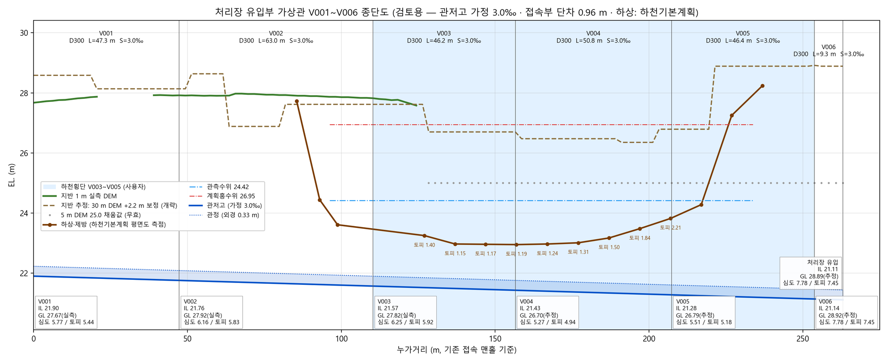
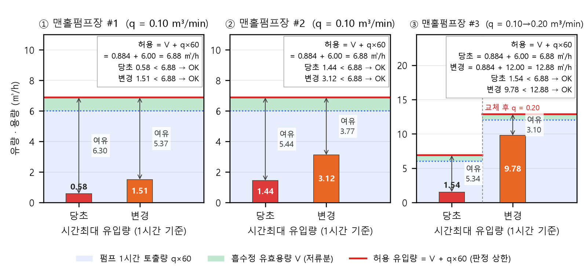

[English](README.en.md) | 한국어

# qgis-water-sewer-kit — Claude와 함께하는 QGIS 하수관로 설계·검토 키트

QGIS 데이터를 기반으로 하수관로 설계와 검토를 수행하고, 반복 작업은 [Claude Code](https://claude.com/claude-code)에 맡길 수 있도록 만든 스킬 키트다. 팀마다 다른 프로젝트 구조에 맞춰 사용할 수 있으며, 사용자가 절차를 외우는 대신 Claude가 단계별 스킬을 읽고 실행한다.

> 현재는 **하수관로 스킬**만 제공한다. 상수도 스킬은 추후 추가할 예정이다.



스킬과 스크립트는 실제 레이어 이름을 하드코딩하지 않는다. 프로젝트 루트의 `sewer.config.json`에서 레이어·필드·DB·설계 기준을 읽는다. 따라서 레이어 이름이 달라도 데이터를 수정할 필요 없이 설정만 맞추면 된다. 온보딩 스킬이 프로젝트 데이터를 조사해 이 설정 파일을 만든다.

## 시작하는 방법

① **설치** — Claude Code에 [설치 안내](INSTALL.md)를 맡긴다: `https://github.com/taylee9809/qgis-water-sewer-kit 저장소의 INSTALL.md에 따라 설치해 줘`.

② **프로젝트 설정** — 프로젝트 폴더에서 `이 프로젝트에 맞게 키트를 설정해 줘`라고 요청한다. Claude가 데이터를 조사한 뒤, 판단이 필요한 항목만 질문한다(약 5개).

③ **작업 요청 및 결과 확인** — 아래 표에서 필요한 작업을 요청하고, 결과는 「결과 검토 체크리스트」에 따라 확인한다.

**필수 환경:** Claude Code · QGIS 3.22 이상(3.40 LTR 권장) · Python 3.10 이상  
**선택 환경:** PostGIS

## 지원하는 작업

| 이렇게 요청하면 | 스킬 | 결과 | 확인 항목 |
|---|---|---|---|
| `DEM·상수관·유량·가구 자료 가져와 줘` / `가구 자료를 엑셀로 내보내 줘` | 10 | 1 m·5 m DEM, 상수관 GPKG, 유량 기준표, 가구 자료 엑셀 내보내기·재반영 | 원본·적재 행 수 일치 여부, 엑셀 수정 행 외 변경 여부 |
| `측량 성과가 들어왔어. 지장물 레이어 만들어 줘` | 11 | 지장물 폴리곤·중심선 + `확인필요` 레이어 | `확인필요` 목록과 도면·로드뷰의 대조 결과(보통 3~5건) |
| `준공도 DXF를 DB에 넣어 줘` / `준공 DB가 맞는지 확인해 줘` | 12 | 준공 관로·맨홀 적재 + 원본 대조표 | 좌표 오프셋 수렴 여부(0.2 m 이내), 이름·지반고·깊이 불일치 0건 여부 |
| `설계사 평면도 DXF를 계획 레이어로 만들어 줘` | 13 | 계획 관로·맨홀·펌프장 레이어 + 원본 대조 결과 | 관번호·관경·연장 대조 일치 여부, 기존 관로 구분 여부 |
| `이 노선의 관저고와 수리 계산을 해 줘` | 30 | 관저고·관경·유량·판정, makesw `.flo`, 선택 시 SWMM `.inp`, `설계요약.md` | 기준값·Claude 가정 구분 여부, 토피·유속 미달 구간 존재 여부 |
| `펌프장 용량을 산정해 줘` / `기존 펌프장으로 수용 가능한지 확인해 줘` | 31 | 펌프장별 전양정·동력·흡수정 저류, 용량 계산서(엑셀) | 실양정·손실 근거의 타당성, 기존 펌프장 수용 여부 |
| `이 압송관을 없앨 수 있어?` / `접속 맨홀 대안을 비교해 줘` | 32 | 수용 가능한 맨홀 목록 + 대안 비교표 | 토피·심굴착 구간, 운영비 관점의 타당성 |
| `설계사 납품물을 검토해 줘`(폴더명만 지정) | 40 | `검토요약.md` — 연장·계통·접속 관저고·메모 관련 지적 | 각 지적의 `납품값 vs 기준값 — 차이 — 영향` 제시 여부 |
| `종단면도를 A3로 출력해 줘` / `노선별 종단면도를 그려 줘` | 50 | A3 도면집 PDF(리명 포함 제목), 설계사 서식 종단 DXF, 검토용 종단 PDF | 제목 누락·선 잘림 여부, 회전 글자 깨짐 여부 |
| `이 구간의 위치도·삽도를 만들어 줘` | 51 | 조판 + 300 dpi 이미지 | 겹침·잘림·빈 범례 존재 여부(육안 확인) |
| 그 밖의 단계(사업비·보고서·검토 의견) | — | Claude가 프로젝트의 `scripts\`에 전용 스크립트를 작성 | 수치 출처 명시 여부, 기준값·가정 구분 여부 |
| `키트에서 고친 내용을 보내 줘` | 90 | 피드백 꾸러미(수정 사항·실패 기록·새 도구) → PR·이슈·파일 | 고유명 검사 0건 여부, 전송 내용의 적절성 |

## DB 자동 구축

DB를 미리 만들어 둘 필요는 없다. DXF·DEM·엑셀 등 보유 자료를 프로젝트 폴더에 넣고 `이 프로젝트에 맞게 키트를 설정해 줘`라고 요청하면, Claude가 자료 구조를 조사해 표준 스키마의 GPKG와 설정 파일을 만든 뒤 필요한 자료를 단계별로 적재한다. 자동으로 판단하기 어려운 항목만 사용자에게 묻고, DB 구축이 끝나면 같은 흐름에서 설계·검토까지 이어간다.

**자료 업로드 → Claude의 DB 자동 구축 → 설계·검토**

① **자료 업로드** — DXF·DEM·엑셀 등 원본 자료를 프로젝트 폴더에 넣는다.

② **Claude의 DB 자동 구축** — **00** 프로젝트 조사·GPKG·설정 생성 → **10~13** 기초 자료·지장물·기존 관망·계획 노선 적재

③ **설계 계산** — **30** 관저고·수리 계산 → **31** 펌프장 용량 산정 → **32** 대안 비교

④ **도면·납품물 검토** — **50** 종단면도 → **51** 조판·삽도 → **40** 외주 납품물 검토

처리 구역·유량 확정(20)과 사업비·보고서 작성(60~80)은 아직 전용 스킬이 없다. Claude가 방법서(`standard/workflow.md`)에 따라 프로젝트의 `scripts\`에 필요한 스크립트를 작성한다.

## 업무 흐름



요청을 받으면 Claude가 해당 작업의 단계를 판단한다. 전용 스킬이 있는 단계는 스킬에 따라 실행하고, 나머지 단계는 프로젝트 전용 스크립트를 작성한다.

**외주 납품물 검토(40)를 수행하기 전에 준공 DB(12)의 정합성을 먼저 확인해야 한다.**

## 결과물 예시

다음은 실제 과업에서 만든 결과물이다. 지구명·관번호·하천명은 `OO`, `XX-` 등으로 익명 처리했다.

**A3 종단면도** — 설계사 도면 서식에서 관번호·관저고·토피 밴드를 읽어 같은 형식으로 다시 그린다. 외주 검토(40)에서도 이 서식을 판독한다.



**검토용 종단면도** — 처리장 유입부 관로를 하천 횡단·홍수위·토피와 함께 배치해 계획의 성립 여부를 검토한다(30·32).



**맨홀 펌프장 흡수정 저류 검토** — 유입량이 달라져도 펌프 토출량과 저류 용량의 수용 가능 여부를 펌프장별로 판정한다(31).



## 결과 검토 체크리스트

- **원본 보존 여부** — 키트는 원본을 읽기만 하고 산출물은 `_산출\` 아래에 저장한다. DB를 수정한 경우에는 백업 테이블 이름과 변경 건수를 함께 보고해야 한다.
- **`0건`과 `미조사` 구분 여부** — 측량하지 않은 구간의 지장물은 `교차 0건`이 아니라 `미측량`으로 표시해야 한다.
- **기준값과 가정 구분 여부** — 보고서에 사용할 수치는 KDS·과업 기준값 또는 Claude의 가정으로 출처를 명시해야 한다.
- **사람의 최종 판단 여부** — 도면만으로 판단할 수 없는 항목은 확인 목록에 포함돼야 하며, Claude가 임의로 결정해서는 안 된다.

## 구성

| 폴더 | 내용 |
|---|---|
| `skills\` | 스킬 12개 — 00-onboard · 10 · 11 · 12 · 13 · 30 · 31 · 32 · 40 · 50 · 51 · 90-kit-feedback |
| `lib\kitconfig.py` | 모든 스크립트가 사용하는 설정 로더(경로·레이어·필드·DB, 비밀번호는 환경변수로만 관리) |
| `lib\flospec.py` | makesw `.flo` 읽기·검증·쓰기(13·30·31·40 공용) |
| `standard\` | 데이터 표준(논리 레이어·필드) · **DB 설계 가이드**(엔티티·관계·규칙) · 업무 흐름 · 함정 노트 2개 |
| `templates\` | `sewer.config.example.json`(실제 프로젝트 구성 예시) · `db_schema.json`(빈 GPKG·PostGIS DDL을 생성하는 표준 스키마) · 프로젝트용 `CLAUDE.md` |
| `assets\svg\` | 조판·삽도용 SVG 양식 — 제목 상자·범례·키표·검토 구간 태그·로드뷰 배지·지명 라벨·지도 아이콘, 텍스트 생성기 `make_svg.py`(태그 너비 자동 계산), 미리보기 `preview.png` |
| `docs\` | README에 사용하는 이미지 |

## 검증 결과와 알려진 한계

아래 스킬의 스크립트는 실제 프로젝트 데이터로 기존 프로젝트용 도구와 결과를 대조했다.

| 스킬 | 확인 결과 |
|---|---|
| 10 | DEM 배열 일치 |
| 11 | CSV 바이트 단위 일치 |
| 12·32 | 출력 일치 |
| 13 | 관로 1,470개·맨홀 1,234개·펌프 33개 일치 |
| 30 | 종단·수리 190개 구간과 `.flo` 231줄에서 불일치 0건 |
| 31 | 펌프장 17곳 × 38개 항목에서 차이 0건 |
| 40 | A1~A5 결과 일치 |
| 50 | A3 28장의 제목·관번호 일치 |

- 30 스크립트는 맨홀 자동 배치와 터파기·가시설 설계를 지원하지 않는다. 자세한 내용은 [30 스킬 문서](skills/30-route-design/SKILL.md)의 10.6절에 적어 두었다. makesw `.OUT`(수리 계산 결과표)은 makesw 프로그램이 있어야 생성할 수 있다.
- 실제 PostGIS DB를 사용한 읽기 검증은 12·32에서만 수행했다. 11·40은 GPKG로만 확인했으므로 PostGIS를 사용하는 팀은 첫 실행 결과를 한 번 육안으로 확인해야 한다.
- 11 스킬의 지장물 레이어 **쓰기 형식은 GPKG만 지원한다.**
- 13 스킬도 **GPKG에만 쓸 수 있으며**, `--write`를 지정한 경우에만 백업 후 반영한다.
- 11 도구는 설정을 먼저 읽으므로 **프로젝트 폴더 안에서** 실행해야 한다. 프로젝트 폴더 밖에서는 `--help`를 실행해도 설정 안내만 표시된다.
- DXF 레이어 이름과 말풍선 반경 같은 **측량사·설계사별 작도 규약**은 한 업체의 도면을 기준으로 한 예시다. 다른 업체의 도면을 사용할 때는 설정(`asbuilt.dxf_layers`, `review_vendor.profile`) 또는 실행 인자를 변경해야 한다. 11 스킬은 [도구 README](skills/11-survey-to-qgis/tools/README.md)의 레이어 목록도 함께 수정한다.

## 연동 도구

- [Sewer Profile Viewer](https://github.com/taylee9809/qgis-sewer-profile) — 노선 구간 트리와 종단도를 제공하는 QGIS 플러그인. 설치 과정에서 Claude가 함께 설치한다.
- [QGIS MCP](https://github.com/jjsantos01/qgis_mcp) (선택) — Claude가 실행 중인 QGIS를 직접 조작할 수 있게 한다.
- [korean-engineering-mcp](https://github.com/sonmeggy/korean-engineering-mcp) (선택) — KDS/KCS 건설기준·법제처 법령 검색, 인용 검증, 표준품셈 조회를 지원한다. 30 스킬이 조문을 원문으로 확인할 때 사용하며, API 키는 사용자가 직접 발급받아야 한다.

## 피드백 및 업데이트

- 키트는 설치할 때 생성하는 **`local` 브랜치**에서 사용한다. 팀별 수정 사항은 이 브랜치에 커밋으로 남기므로 업데이트해도 사라지지 않는다.
- **사용 방식 공유**는 설치할 때 한 번 동의한 경우에만 활성화된다. 활성화하면 Claude Code 세션의 시작·종료 시점에 키트 관련 정보만 추출해 해당 팀의 포크(fork)로 전송한다.

  - **공유 항목:** 사용한 스킬·스크립트, 성공·실패 여부와 마지막 오류 줄, `local` 브랜치 수정 사항, 설정 구조
  - **공유하지 않는 항목:** 대화 내용, 프로젝트 데이터, 설정 파일, 산출물
  - 프로젝트 경로·지구명·업체명은 제거하며, 고유 정보가 감지되면 전송하지 않는다.

- 관리자는 `collect_feedback.py`로 팀별 사용량, 같은 오류끼리 묶은 실패 순위, 팀별 수정 사항과 패치를 취합한다.
- 공유를 활성화하지 않은 팀은 Claude에게 `키트에서 고친 내용을 보내 줘`라고 요청할 수 있다. 90-kit-feedback이 전송용 꾸러미를 만들고 고유명을 검사한 뒤, **사용자의 승인을 받아** PR·이슈·파일 중 하나로 전송한다.
- 관리자가 회귀 검증을 포함한 검토 후 변경 사항을 병합하면 다음 업데이트 때 모든 사용자에게 반영된다. 병합되지 않은 수정 사항은 해당 팀의 `local` 브랜치에 남아 계속 사용할 수 있다.
- 업데이트는 다음 명령으로 진행한다. 정션으로 설치하므로 스킬을 다시 연결할 필요는 없다.

  ```powershell
  git -C <키트> fetch origin
  git -C <키트> rebase origin/main
  ```

- 자세한 규칙은 [CONTRIBUTING.md](CONTRIBUTING.md), 관리자 절차는 [MAINTAINING.md](MAINTAINING.md), 변경 기록은 [CHANGELOG.md](CHANGELOG.md)에서 확인할 수 있다.

