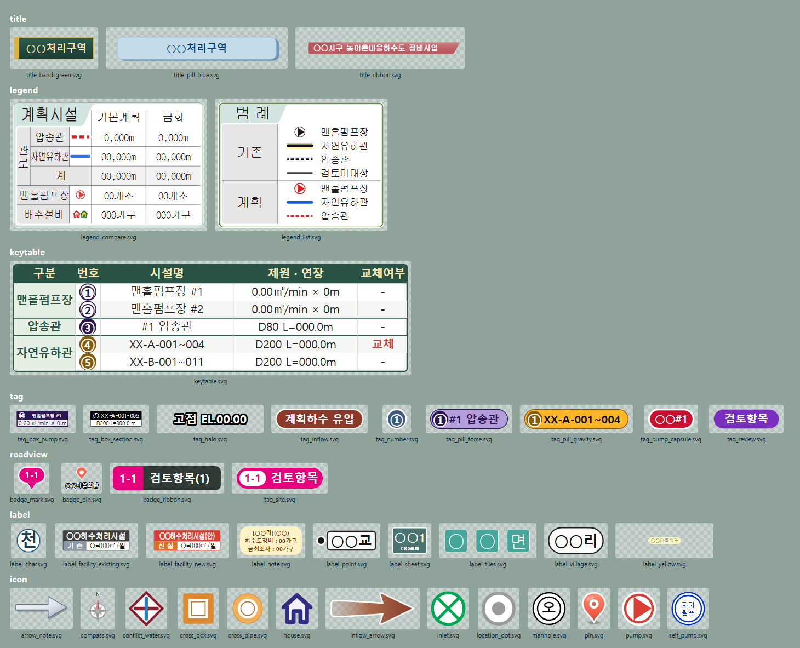

# 조판·삽도 SVG 양식

QGIS 조판(인쇄 레이아웃)과 지도 심볼에 쓰는 SVG 양식 모음이다. 제목 상자, 범례, 검토구간 딱지, 로드뷰 배지, 지명 라벨, 키표, 지도 아이콘이 들어 있다.
글자는 자리표시(`○○처리구역`, `XX-A-001~004`, `○○리`)로 되어 있고, 프로젝트 글자를 넣은 사본은 `make_svg.py` 로 여러 장을 한 번에 찍는다.



## 목록

| 폴더 | 파일 | 모양 | 쓰는 곳 | `make_svg.py` type |
|---|---|---|---|---|
| `title/` | `title_band_green.svg` | 진녹 그라데이션 상자, 금색 테두리, 왼쪽 금색 띠 | 처리구역·도면 제목 | `title_band` |
| | `title_ribbon.svg` | 사선 리본(와인색), 굴림체 흰 글자, 위쪽 광택 | 사업명 머리띠 | `title_ribbon` (`color` 로 남색 등) |
| | `title_pill_blue.svg` | 하늘색 알약 + 오른쪽 아래 그림자 | 부제·구역 제목 | `title_pill` |
| `legend/` | `legend_list.svg` | 민트 테두리, 흰 본문, 왼쪽 위 '범례' 탭, 기존/계획 구분열 | 기존시설 검토도 범례 | `legend_list` (`items`) |
| | `legend_compare.svg` | 같은 틀의 비교표(관로·맨홀펌프장·배수설비 × 두 열) | 계획평면도 계획시설 범례(기본계획/금회 등) | `legend_compare` (`values`) |
| `keytable/` | `keytable.svg` | 진녹 머리줄, 구분 열 연녹 띠, 짝수행 음영, 번호 원 | 지도 밖 제원표(구분/번호/시설명/제원·연장/비고) | `keytable` (`rows`) |
| `tag/` | `tag_pill_gravity.svg` | 주황 알약 + 갈색 번호 원 | 검토 자연유하 구간 | `tag_pill` |
| | `tag_pill_force.svg` | 보라 알약 + 남보라 번호 원 | 검토 압송관 | `tag_pill` (`kind: press`) |
| | `tag_number.svg` | 남색 번호 원(흰 테) | 검토구간 색띠 옆 번호 | `tag_number` |
| | `tag_box_pump.svg` | 진보라 머리띠 + 흰 원 번호 + 제원 줄 | 맨홀펌프장 제원 | `tag_box_pump` |
| | `tag_box_section.svg` | 검정 머리띠(번호·관번호) + 흰 본문(관경·연장) | 구간 제원 | `tag_box_section` |
| | `tag_review.svg` | 단색 캡슐 | 검토사항(하천하월·관매달기 …) | `capsule` (`fill`) |
| | `tag_pump_capsule.svg` | 빨강 캡슐, 흰 테 | 신설 펌프장 `○○#1` | `capsule` (`preset: pump`) |
| | `tag_inflow.svg` | 고동색 캡슐, 흰 테 | 계획하수 유입 표시(`icon/inflow_arrow.svg` 와 짝) | `capsule` (`preset: inflow`) |
| | `tag_halo.svg` | 흰 글자 + 검정 후광 | 고점·표고 표시 | `tag_halo` |
| `roadview/` | `badge_mark.svg` | 번호 알약 + 꼭지(위/아래) | 지도의 사진 지점 | `badge_mark` |
| | `badge_pin.svg` | 빨간 핀 + 이름(후광) [+ 번호칩] | 유입지점·주요 지점 | `badge_pin` |
| | `badge_ribbon.svg` | [색 번호칩] + 먹색 띠 제목 | 사진 왼쪽 위 표제 | `badge_ribbon` |
| | `tag_site.svg` | 색 알약 + 흰 번호캡슐 | 지도의 사진 지점(큰 딱지) | `tag_site` |
| `label/` | `label_village.svg` | 흰 알약, 굵은 검정 테 | 리(마을) 이름 | `label_village` |
| | `label_point.svg` | 검정 점 + 흰 상자 | 교량·회관 등 지점 이름 | `label_point` (`side`) |
| | `label_yellow.svg` | 노란 캡슐(굴림 작은 글자) | 처리구역명·필지·지점 | `label_yellow` |
| | `label_tiles.svg` | 글자마다 청록 네모 칸 | 읍·면 이름 | `label_tiles` |
| | `label_char.svg` | 한 글자 원 | 하천명을 선 따라 한 자씩 | `label_char` |
| | `label_facility_existing.svg` | 회색 머리띠 + '기 존' + 용량 | 기존 처리시설 | `label_facility` |
| | `label_facility_new.svg` | 빨강 머리띠 + '신 설' + 용량 | 계획 처리시설 | `label_facility` (`kind: new`) |
| | `label_sheet.svg` | 진청록 상자, 번호 + 부제 | 도면(용지) 번호표 | `label_sheet` |
| | `label_note.svg` | 둥근 색 상자, 가운데 맞춤 여러 줄 | 조판 메모(가구수 등) | `label_note` (`preset`) |
| `icon/` | `manhole.svg` · `inlet.svg` · `self_pump.svg` | 오수맨홀 · 오수받이 · 자가펌프 | 배수설비 평면 | 정적 파일 |
| | `house.svg` | 집(배수설비 가구) | 가구 위치 | `icon_house` (색) |
| | `pump.svg` | 흰 원 + 색 테 + 토출 삼각형 | 맨홀펌프장 | `icon_pump` (색) |
| | `inflow_arrow.svg` | 그라데이션 굵은 화살표 | 유입 방향 | 정적 파일 |
| | `compass.svg` | 나침반 방위표 | 조판 방위 | 정적 파일(`template` 로 색 바꿈) |
| | `pin.svg` · `location_dot.svg` | 장소핀 · 회색 위치점 | 지점 표시 | 정적 파일 |
| | `cross_pipe.svg` · `cross_box.svg` · `conflict_water.svg` | 원형관 횡단 · BOX 횡단 · 상수관 간섭 | 지장물 검토 기호 | 정적 파일 |
| | `arrow_note.svg` | 회색 화살표 | 메모 상자 옆 지시 | 정적 파일 |

색 프리셋(같은 모양, 뜻만 다름):
- 집: 기존 `#F4F2FF`/`#312E81`(기본) · 계획 `#FEF2F2`/`#DC2626` · 계획(저지대) `#FFE200`/`#166534`
- 펌프장: 계획 `#DB3F33`(기본) · 기존 `#231815`
- 검토 캡슐(`capsule` 의 `fill`): 하천하월 `#7B2FBE` · 관매달기 `#E6007E` · 기존펌프 용량 검토 `#B03A48` · 상수관 병렬매설 `#F9A825` · BOX횡단 `#C87A2A` · 자연유하관 `#0B5BD3` · 압송관 `#E60012` · 자가펌프 `#7A9A3C` · 기존 오수맨홀 연결 `#7B3FA0` · 구거횡단 `#00897B`
- 메모 상자(`label_note` 의 `preset`): `cream` · `mint` · `wine` · `indigo` · `slate` · `amber`

## QGIS 에서 쓰는 법

**SVG 폴더 두는 곳.** 프로젝트 폴더 아래에 `svg\` 를 만들고 쓸 파일을 복사한다. 프로젝트 속성 → 일반 → 경로 저장을 **상대 경로**로 둔다.
절대경로로 저장하면 다른 PC 에서 물음표 심볼이 된다. 설정 → 옵션 → 시스템 → SVG 경로에 그 폴더를 더해 두면 심볼 고르는 창에 바로 뜬다.

**지도 심볼(마커).** 레이어 스타일 → 심볼 → 마커 → 심볼 레이어 종류 `SVG 마커` → 파일을 고른다. 크기는 mm 로 준다(아이콘 6~12 mm, 딱지 높이 5~7 mm 안팎).
글자가 피처마다 다르면(구간 번호·지점 이름) SVG 마커보다 라벨(배경 = 알약/원)이 낫다. 51 스킬 2절 PAL 규칙을 따른다.

**조판 그림 아이템.** 조판 → 그림 추가 → SVG 이미지 → 파일을 고르고 크기 조정 모드를 **Zoom(비율 유지)** 로 둔다.
딱지 글자가 길어져 viewBox 폭이 바뀌면 아이템 폭도 같이 늘린다: **아이템 폭 = 아이템 높이 × viewBox 폭 / viewBox 높이**.
`make_svg.py --item-height 7.2` 처럼 높이를 주면 장마다 이 폭을 찍어 준다.
제목·범례·키표처럼 조판에 한 번 놓는 것은 그림 아이템으로 놓고, 숫자를 바꿀 때는 SVG 를 다시 찍어 같은 경로에 덮어쓴다(조판을 다시 열면 바뀐 그림이 나온다).

**배포.** QGIS 프로젝트를 다른 사람에게 넘길 때는 이 SVG 폴더를 **같이 묶는다**(킷 `standard\pitfalls-qgis-postgis.md` 「프로젝트 배포」).

## QGIS(QtSvg) 에서 깨지지 않게
QGIS 는 SVG 를 Qt 의 QtSvg 로 그린다. 브라우저에서 멀쩡해도 QGIS 에서 달라지는 것이 있어 템플릿은 아래를 지켰다. 손으로 고칠 때도 지킨다.

| 하지 말 것 | QGIS 에서 생기는 일 | 대신 |
|---|---|---|
| `font-family="맑은 고딕, Malgun Gothic, sans-serif"` 같은 목록 | 목록을 못 읽고 기본 글꼴로 그린다(굴림체 범례가 맑은 고딕으로) | 이름 하나만: `Malgun Gothic` · `Gulim` · `GulimChe` |
| 글자 테두리 `stroke` 로 후광 | 테두리가 안 그려진다 | 같은 글자를 여러 방향으로 겹쳐 그린다(`tag_halo`, `badge_pin`) |
| `dominant-baseline="central"` | 무시된다(글자가 위로 뜬다) | 기준선 y 를 직접 준다(`label_note`) |
| CSS class 의 글자 크기 + `font-family` 속성 섞기 | 글자 크기가 틀어진다 | 글자 속성은 전부 요소 속성으로 |
| 그림(`<image>` base64)·지도 캡처 넣기 | 무겁고 해상도가 고정된다 | 벡터로 그린다 |

그라데이션(`linearGradient`·`radialGradient`), 반투명(`fill-opacity`), 둥근 모서리(`rx`)는 그대로 된다.

## 글꼴
Windows 기본 글꼴만 쓴다: **맑은 고딕(Malgun Gothic)**, **굴림(Gulim)**, **굴림체(GulimChe)**.
없는 PC(리눅스·맥 QGIS)는 글꼴 이름을 바꿔 다시 찍는다. QGIS 는 이름 하나만 읽으므로 대체 목록을 넣는 방법은 안 된다.

```
python make_svg.py --templates --sans "NanumGothic" --gulim "NanumGothic" --gulimche "NanumGothicCoding"
python make_svg.py spec.json -o out --sans "Noto Sans KR"
```
정적 아이콘 중 글자가 있는 것은 `icon/self_pump.svg`(굴림) 하나다. 나침반의 N 은 도형이라 글꼴이 필요 없다.

## make_svg.py — 글자 넣어 여러 장 찍기
파이썬 표준 라이브러리만 쓴다(QGIS 파이썬이든 일반 파이썬 3.8 이상이든 된다).

```
python make_svg.py --list                              # type 목록·인자·기본값
python make_svg.py examples/spec.json -o out           # JSON 목록 → SVG 여러 장
python make_svg.py examples/spec.csv  -o out --item-height 7.2
python make_svg.py --sheet out/sheet.html out          # 찍은 SVG 를 한 장 HTML 로(브라우저로 검사)
python make_svg.py --templates                         # 이 폴더 템플릿 다시 만들기
```

- **JSON**: 객체 하나 = SVG 한 장. `type`·`out` 말고는 그 type 의 인자다. 빠진 인자는 템플릿 값.
  ```json
  [{"type": "tag_pill", "out": "구간1.svg", "no": 1, "text": "XX-A-001~004"},
   {"type": "tag_pill", "out": "구간2.svg", "no": [5, 6], "text": "XX-B-001~011, XX-C-001~003"},
   {"type": "capsule",  "out": "하천하월.svg", "text": "하천하월", "fill": "#7B2FBE"},
   {"type": "keytable", "out": "키표.svg", "rows": [["맨홀펌프장", 1, "맨홀펌프장 #1", "0.13㎥/min × 9m", "-"]]},
   {"type": "template", "out": "방위_남색.svg", "src": "icon/compass.svg", "replace": {"#ba585e": "#1F4E79"}}]
  ```
- **CSV**: 첫 줄이 열 이름(`type,out,no,text,kind,fill,preset,lines` …). 빈 칸은 기본값. 여러 줄 글자는 `|` 로 나눈다(`lines` = `첫줄|둘째줄`). 표·목록(`rows`·`items`·`values`)은 JSON 으로 쓴다.
- **번호** `no`: `1` → ①, `[5, 6]`·`"5,6"` → ⑤⑥, 50 까지 원문자. 이미 `①`·`1-1` 같은 글자면 그대로.
- **`template` type**: 아무 SVG(정적 아이콘 포함)에 글자 바꾸기 `replace` 를 적용한다. 색만 바꿀 때 쓴다.
- 예시: `examples/spec.json`(종류마다 한두 장), `examples/spec.csv`(딱지 묶음).

### 딱지 폭 규칙 (`tag_pill`)
```
viewBox 폭 = 145.5 + (글자수 - 12) × 9   (+ 20 × (번호 글자수 - 1)),  높이 30
```
- 글자수는 영숫자·기호를 1, 한글·전각을 15/9 로 센다(글꼴 15 에서 영숫자 ≈ 0.6 em = 9, 한글 1 em = 15). 관번호 `XX-A-001~004`(12자)가 기준 145.5 다.
- 번호가 두 개(⑤⑥)면 원 배지가 알약 배지로 바뀌고 20 넓어진다(본문 글자도 20 오른쪽으로).
- 조판 아이템은 Zoom 이라 viewBox 가 바뀌면 **아이템 폭 = 높이 × viewBox 폭 / 30** 으로 같이 늘린다(`--item-height`).
- 다른 딱지도 글자에 맞춰 폭이 늘어난다(캡슐 = 글자 폭 + 여백, 제목 상자 = 글자 폭 + 27). 글자 폭은 어림값이라 긴 글자·특수기호는 `--sheet` 로 눈으로 본다.

## 검사
찍은 SVG 는 두 가지로 본다.
1. 브라우저: `python make_svg.py --sheet out/sheet.html out` 후 열거나 headless Edge 로 PNG 를 찍는다.
   ```
   msedge --headless --disable-gpu --screenshot=sheet.png --window-size=1600,1400 file:///<절대경로>/out/sheet.html
   ```
2. QGIS 와 같은 렌더러: 조판에 하나 놓고 미리보기, 또는 QGIS 파이썬에서 `PyQt5.QtSvg.QSvgRenderer` 로 PNG 를 찍는다. 글꼴·후광·기준선이 브라우저와 같은지 본다.
