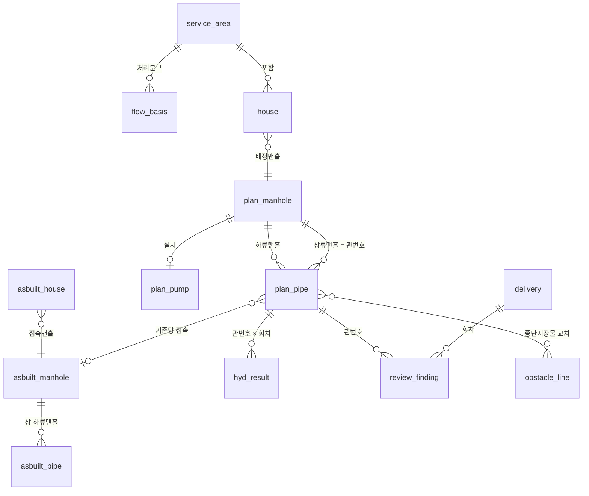

# DB 설계 가이드 — 처음 DB 를 잡을 때

`data-standard.md` 는 **이미 있는 데이터**를 킷에 맞추는 문서다. 이 문서는 **DB 를 처음 만드는 프로젝트**가
어떤 엔티티(레이어·표)를 어떤 관계로 두면 되는지 정한다. 실제 정의는 `templates/db_schema.json` 한 곳에 있고,
`skills/00-onboard/scripts/make_empty_db.py` 가 그 정의로 빈 GPKG·PostGIS DDL·설정 파일을 만든다.

```
python -X utf8 <킷>\skills\00-onboard\scripts\make_empty_db.py --gpkg data\sewer.gpkg --write-config sewer.config.json
python -X utf8 <킷>\skills\00-onboard\scripts\make_empty_db.py --sql schema.sql --schema public     # PostGIS
```
이름은 예시 설정과 같아서, 만든 직후 `check_config.py` 가 그대로 통과한다. 이름을 바꾸고 싶으면 바꾸고 설정만 맞추면 된다.

## 엔티티와 관계



| 묶음 | 논리 키 | 이름(예시) | 기하 | 하는 일 |
|---|---|---|---|---|
| 기준 | `service_area` | 처리구역 | 면 | 처리분구 경계. 과업 범위 판정 |
| 기준 | `flow_basis` | **유량기준** | 표 | 분구별 계획하수량의 **단일 원천**. 수리계산은 이 표만 읽는다 |
| 계획 | `plan_manhole` | 계획맨홀_실시설계 | **점** | 관망의 노드 |
| 계획 | `plan_pipe` | 노선_실시설계 | 선 | 관망의 링크. 상류 → 하류, 관번호 = 상류 맨홀번호 |
| 계획 | `plan_pump` | 맨홀펌프장_실시설계 | 점 | 신설만 산정, 기존은 준공 스펙 |
| 계획 | `house` | 배수설비가구_실시설계 | 점 | 유량이 들어오는 곳. 맨홀에 배정 |
| 준공 | `asbuilt_*` | asbuilt_pipe_burwon 등 6종 | 선/점 | 준공도 판독 **원본 값 그대로** |
| 현황 | `obstacle_poly` · `obstacle_line` | 지장물_폴리곤·중심선_정본 | 면/선 | 11 스킬 출력 |
| 현황 | `water_pipe` · `road_boundary` · `bridge` · `parcel` | — | 선/면 | 외부 자료(공공데이터·관리청). 들여오기만 하고 고치지 않는다 |
| 회차 | `hyd_result` | **수리계산_회차** | 표 | 회차마다 결과 행을 더한다 |
| 회차 | `delivery` · `review_finding` | 납품회차 · **검토지적** | 표/점 | 외주 검토 단위와 지적 이력 |
| 회차 | `decision` | 결정기록 | 표 | 기준값·대안 결정과 근거(`결정기록.md` 로 대신해도 됨) |

## 규칙 — 우리 DB 에서 실제로 겪은 것에서 나왔다

| 규칙 | 왜 (겪은 일) |
|---|---|
| **맨홀은 점(Point)** 으로 | 계획맨홀을 폴리곤으로 둬서 모든 스크립트가 `centroid()` 를 거쳐야 했다 |
| **관로 방향 상류 → 하류**, 관번호 = 상류 맨홀번호 | 방향이 반대인 도형 때문에 끝점 맨홀 배정이 틀어졌다. 온보딩 검사가 '갈라지는 노드'로 잡는다 |
| **(지구, 관번호)·(지구, 맨홀번호) 유일** | 준공 관로에 관번호 중복 9종이 섞여 있었다 → GPKG 는 유일 인덱스, PostGIS 는 `UNIQUE` |
| **코드값은 정해진 것만** (`codes`) | 준공 관로 `구분` 에 9가지 표기가 섞여(오수라인·PIPE·1.오수관로 …) 판정이 흔들렸다 → PostGIS `CHECK`, GPKG 는 검사기로 |
| **계획 표의 필수 필드는 비우지 않는다. 준공 표는 도면에 없는 값을 지어내지 않고 비워 둔다** | 준공 맨홀 지반고 63%·깊이 66% 만 채워져 A4 검토에서 빠지는 맨홀이 생겼다. 그렇다고 기존폐쇄 관로·이름 없는 소형맨홀에 값을 지어 넣으면 더 나쁘다 → 준공 표는 빈 값을 허용하고 `check_config.py` 채움률로 본다 |
| 모든 행에 **자료기준일·출처** | "이 값 어디서 왔나" 를 물을 때마다 원본을 다시 찾았다 |
| **회차 결과는 별도 표**(수리계산_회차) | 관로 레이어에 `금회_`·`변경_YYMMDD` 열을 계속 쌓다가 39열이 됐다. 최신값만 관로에 두고 이력은 표로 |
| **준공(원본)과 계획(판단)을 섞지 않는다** | 준공 DB 의 맨홀 번호가 도형과 반대로 들어가 있어 외주 지적이 서지 않았다. 원본 판독값과 설계값은 다른 표에 |
| **유량은 한 곳에서** | 엑셀 사본·스크립트 상수·레이어 값이 서로 달라 누가유량이 어긋났다 → 유량기준 표가 단일 원천 |
| 좌표계 하나, 단일 기하형 | Multi·혼합 기하는 판정 스크립트마다 예외 처리를 부른다 |
| 고치기 전 백업 `<표>_bak_YYMMDD` | 되돌릴 일이 생각보다 자주 있다 |

## GPKG 로 할까, PostGIS 로 할까

| | GPKG | PostGIS |
|---|---|---|
| 맞는 경우 | 한두 명, 한 PC, 파일로 주고받기 | 여럿이 동시에 편집, 여러 PC 의 QGIS, 큰 자료 |
| 제약·검사 | 유일 인덱스만. 코드값·필수는 `check_config.py` 로 | `NOT NULL`·`CHECK`·`UNIQUE` 가 DB 에서 막는다 |
| 외부 전달 | 파일째 | GPKG 로 내보내 배포(상대경로·SVG 동봉 — 함정 노트 「프로젝트 배포」) |
| 비밀번호 | 없음 | 환경변수(`SEWER_PG_PASSWORD`)로만 |

우리 팀은 PostGIS 를 원본으로 쓰고, 다른 사람에게 줄 때 GPKG 로 내보낸다. 처음이면 GPKG 로 시작하고, 여럿이 동시에 고치게 되면 같은 스키마(`--sql`)로 PostGIS 로 옮기면 된다.

## 계산은 뷰로
펌프 전양정처럼 여러 표를 엮어 계산하는 값은 **뷰(VIEW)** 로 두면 입력이 바뀔 때 결과가 따라온다(PostGIS).
예: 펌프장 × 손실 항목 표 → 전양정·동력 뷰. 뷰 결과를 다시 관로 레이어에 복사해 두지 않는다.

## 처음 만든 뒤 할 일
1. `make_empty_db.py --gpkg … --write-config …` 로 빈 DB 와 설정을 만든다.
2. 외부 자료(상수관·도로경계·교량·지적·DEM)를 들여오고 설정의 `layers`·`dem` 에 더한다.
3. 처리구역·유량기준부터 채운다 → 11(지장물)·12(준공) 스킬로 현황을 넣는다 → 계획 노선은 설계사 납품 또는 30 스킬로.
4. `check_config.py` 로 매번 확인한다(필수 필드 채움률·코드값·방향·중복).
