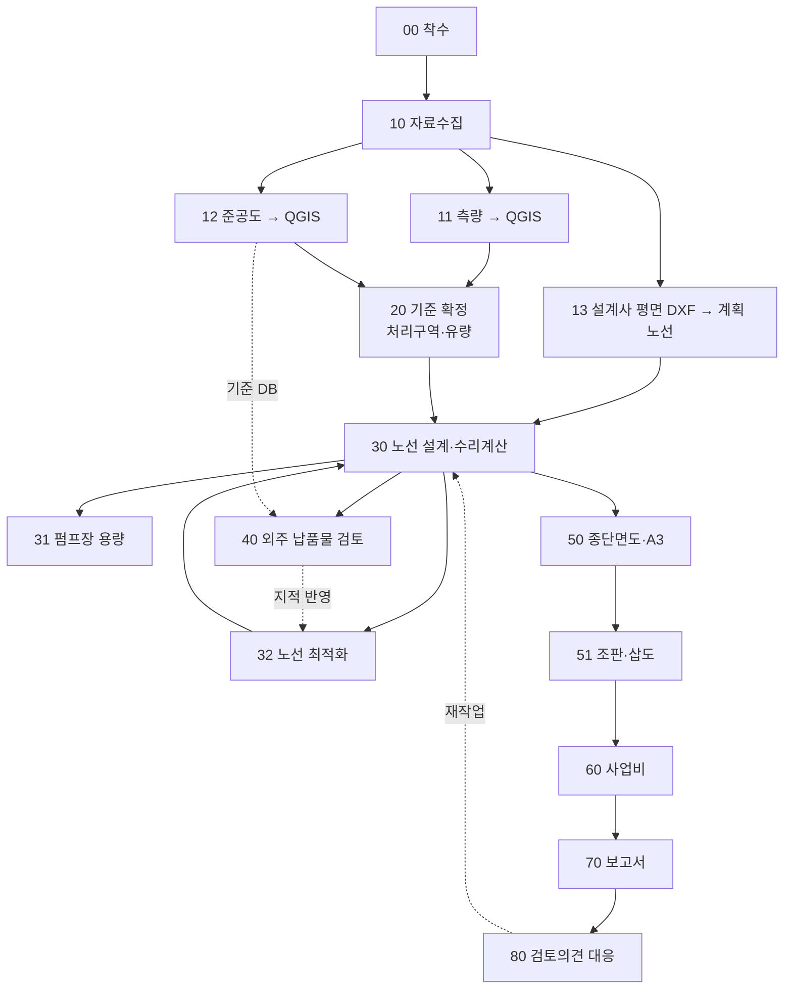

# 업무 흐름 — 단계 00~80

하수관로 기본·실시설계에서 반복되는 작업을 15단계로 나눈 지도. Claude 는 요청이 어느 단계인지 먼저 정하고,
그 단계에 스킬이 있으면 스킬을, 없으면 아래 「스킬 없는 단계」의 방법으로 일한다.

## ★ 순서 규칙
- **40(외주 검토)은 12(준공 DB)가 맞아야 성립한다.** 납품물 관저고를 따지려고 준공 DB 를 열었더니 준공 DB 의 맨홀 번호가 도형과 반대로 들어가 있던 적이 있다. 40 전에 12 정합성을 확인한다.
- **30 은 11·20 이 끝나야 의미가 있다.** 지장물·유량이 비어 있으면 "교차 0", "유량 0" 이 아니라 **미조사**로 보고한다.

## 단계표

| 단계 | 입력 | 산출 | 스킬 | 합격·확인 기준 |
|---|---|---|---|---|
| 00 착수 | 계약서·과업지시서 | 폴더 규칙, `sewer.config.json` | **00-onboard** | 설정 검사 통과 |
| 10 자료수집 | 발주처 제공 자료·DEM·상수관 DXF·유량·가구 조사 | DEM GeoTIFF·상수관 GPKG·유량기준 표·가구 엑셀 왕복 | **10-data-intake** | 자료 목록과 출처, 들인 행 수 = 원본 행 수 |
| 11 측량 → QGIS | 측량현황도 DXF | 지장물 폴리곤·중심선·확인필요 | **11-survey-to-qgis** | 품질 플래그 0, 확인 목록 3~5건 |
| 12 준공도 → QGIS | 준공도 DXF | `asbuilt_*` | **12-asbuilt-ingest** | 원본과 이름·지반고·깊이 전건 일치, 체인 무결성 |
| 13 설계사 평면 DXF → 계획 노선 | 납품 평면 DXF(+ `.flo`) | 계획 관로·맨홀·펌프장 레이어 | **13-plan-dxf-ingest** | 관번호·관경·연장 대조 불일치 0 |
| 20 기준 확정 | 기본계획·준공 DB·배수설비조사 | 처리구역·분구별 유량·세대수 | — | 출처가 붙은 유량표 |
| 30 노선 설계·수리계산 | 노선·상수관·지장물·DEM·유량 | 관저고·관경·`.flo/.OUT`·QGIS 레이어 | **30-route-design** | 토피·경사·유속 판정, 기준값/자체가정 구분 표기 |
| 31 펌프장 용량 | 유입관저고·압송연장·토출점 | 용량계산서(전양정·동력·흡수정) | **31-pump-capacity** | 원 계산서 방식 재현 |
| 32 노선 최적화 | 노선·준공 DB·지장물·DEM | 대안 비교표 | **32-route-optimize** | 최소경사·토피 성립 |
| 40 외주 납품물 검토 | 납품 폴더(평면·종단 DXF, .flo/.OUT) | 검토요약.md | **40-review-vendor** | A1~A5 지적 0 또는 지적사항 목록 |
| 50 종단면도 | 노선·수리 결과 또는 설계사 종단 DXF | 종단면도 DXF·A3 PDF(리명 제목)·검토용 종단 | **50-profile-sheets** | 제목 누락 0·잘린 선 0, 밴드값이 레이어 값과 일치 |
| 51 조판·삽도 | QGIS 프로젝트 | 평면도·보고서 삽도 | **51-layout-figure** | 겹침·잘림·빈 범례 0 (눈으로 확인) |
| 60 사업비 | 관로 연장·관경 집계 | 사업비 워크북 | — | 단가 출처·적용연도 명기 |
| 70 보고서 | 집계표·삽도·계산서 | 보고서(hwpx 등) | — | 본문 수치 = 집계표 |
| 80 검토의견 대응 | 검토의견 | 수정본 + 근거자료 | — | 의견별 조치·근거 1:1 |

## 스킬 없는 단계에서 Claude 가 하는 일
- 프로젝트 `scripts/` 폴더에 그 단계용 스크립트를 짠다. 경로·레이어·필드는 반드시 `kitconfig` 로 읽는다(하드코딩 금지).
- 산출물은 `outputs.root` 아래에만 쓴다. 원본 자료 폴더는 읽기 전용.
- 두 번 이상 반복된 절차는 스킬로 올리자고 사용자에게 제안한다(SKILL.md + scripts, 이 킷 형식 그대로).
- 수치를 보고할 때는 **기준값(KDS·조례)과 자체 가정을 구분**해 적는다. 임계값을 바꿨으면 숨기지 않는다.
